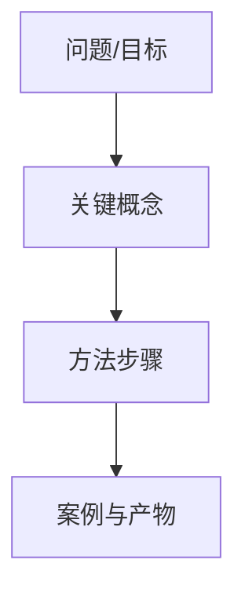

# 输出模板

## 单份主笔记

```markdown
---
title: "课程标题｜章节标题"
course: "课程名称"
source: "原始文件名"
tags:
  - 学习笔记
  - 课程主题
status: "待复习"
created: YYYY-MM-DD
---

# 课程标题｜章节标题

> [!abstract] 一句话结论
> 用一句话说明本节解决的实际问题。

## 输入与证据质量

- 原始文件/材料类型：……
- 转录、OCR、截图的可靠程度：……
- 可追溯范围：时间戳/页码/段落号……
- 已知缺口：……

## 本节学习目标

- 能够……（来源锚点）

## 关键结论

| 结论 | 证据/来源 | 适用边界 |
| --- | --- | --- |

## 知识地图



## 详细笔记

### 概念/方法名称

**课程原话：** …… `[P01 00:00]`

**结构化提炼：** ……

**为什么重要：** ……

**怎么做：**

1. ……
2. ……

**案例/例子：** ……

**不适用或边界：** ……

## 定义（Definitions）

**术语**
精确定义；若是课程自定义，注明“课程语境下”。

## 实操 SOP

| 步骤 | 输入 | 动作 | 产物 | 验收标准 |
| --- | --- | --- | --- | --- |

## 坑点与隐患

> [!warning] 常见坑
> **表现：** ……  
> **原因：** ……  
> **后果：** ……  
> **规避：** ……

## 实操延伸

明确标注哪些内容不是课程原话，而是为落地补充的建议。

## 待确认项

- `【待确认：原文“...”｜疑似“...”｜依据/缺口：...】` `[原稿第 N 段]`

## 来源与证据说明

- 原始文件：……
- 使用的转录/截图：……
- 证据范围与不足：……
```

## 复习题与闪卡

```markdown
# 复习题与闪卡｜课程标题

## 主动回忆题

### 回忆题
1. 问题……

<details>
<summary>参考答案</summary>

答案……（来源锚点）
</details>

### 解释题
1. 为什么……？请引用原理或证据。

### 对比题
1. A 与 B 的目标、适用条件和风险有什么不同？

### 场景题
1. 如果……你会如何选择？请写出判断依据和边界。

### 实操题
1. 使用给定输入完成……，提交产物并按验收标准自检。

### Thinking 场景题
1. 如果……你会如何选择？请写出判断依据、步骤和风险。

## Recall Cards

| Front | Back | Source |
| --- | --- | --- |

## Thinking Cards

| Situation/Question | Reasoned Answer | Source |
| --- | --- | --- |

## 复习节奏

- 第 0 天：不看答案完成主动回忆。
- 第 1/3/7/14 天：只复习答错或不完整的卡片。
- 完成一次实操后：把错因补回主笔记的“坑点与隐患”。
```
